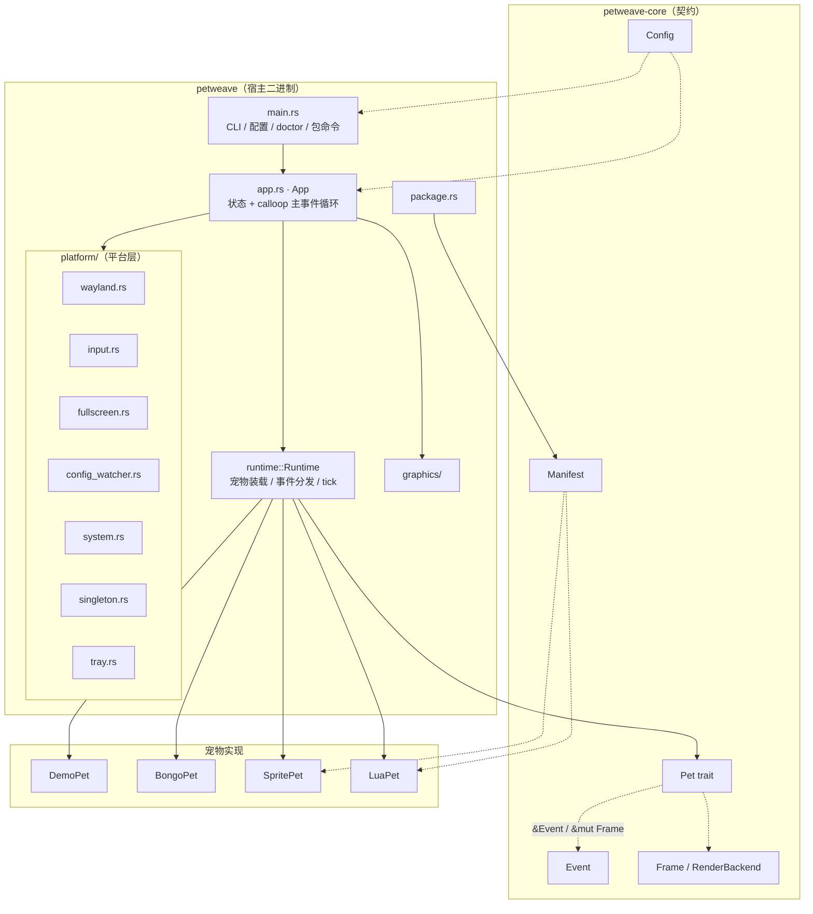
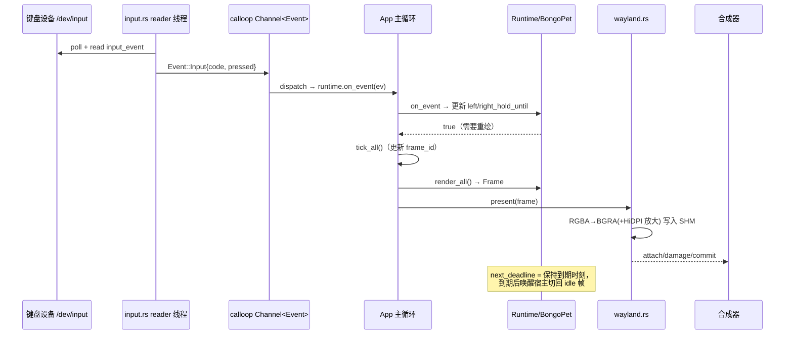
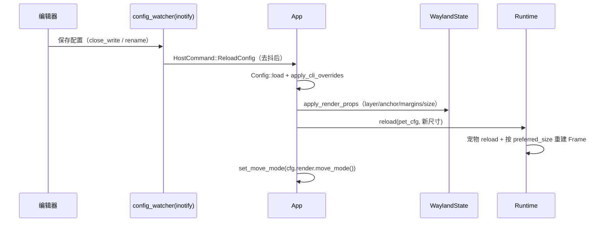

# PetWeave 架构说明

> 本文描述 PetWeave 当前代码库（截至 M3 完成 + M3.5 G0 多宠物运行时）的实际架构，而不是规划愿景。
> 目标是让新贡献者能在 10 分钟内建立"代码在哪、数据怎么流、扩展点在哪"的心智模型。
>
> 相关文档：技术选型与背景见 [TECH_STACK.md](TECH_STACK.md)，里程碑与完成度见
> [ROADMAP.md](ROADMAP.md)，角色包制作见 [PACKAGES.md](PACKAGES.md)。

---

## 1. 设计目标

PetWeave 是 **Wayland 原生的桌宠框架**（而非单一桌宠应用），核心目标：

1. **轻量**：CPU/SHM 软件渲染，无 WebView / GTK / Qt，单宠物空闲 RSS ≈ 5MB、CPU ≈ 0%。
2. **平台化**："做一个桌宠" = "写一个角色包"，通过稳定的事件/渲染契约把宿主与宠物解耦。
3. **原生 Wayland**：`wlr-layer-shell` 定位、`xdg-output` 多显示器、HiDPI `buffer_scale`、
   `wlr-foreign-toplevel-management` 全屏隐藏。
4. **零代码优先，脚本按需**：声明式精灵包（`pet.toml`）覆盖大多数场景，Lua 沙箱覆盖逻辑场景。

---

## 2. 仓库结构

Cargo workspace，两个 crate，边界就是"可复用契约"与"宿主实现"的分界：

```
petweave/
├── crates/
│   ├── petweave-core/        # 共享契约 crate：不含任何 Wayland/平台代码
│   │   └── src/
│   │       ├── lib.rs        # 模块声明 + 公共 re-export + VERSION
│   │       ├── config.rs     # 宿主配置（TOML）+ 校验 + MoveMode
│   │       ├── events.rs     # 宿主 → 宠物的事件枚举
│   │       ├── pet.rs        # Pet trait（宠物作者实现的唯一抽象）
│   │       ├── render.rs     # Frame（RGBA8 软件帧）+ RenderBackend trait
│   │       ├── manifest.rs   # 角色包清单 pet.toml 结构与校验
│   │       └── error.rs      # core 错误类型
│   └── petweave/             # 宿主二进制（bin: petweave）
│       └── src/
│           ├── main.rs       # 入口：CLI 分发、配置加载、doctor、包命令
│           ├── cli.rs        # clap 定义
│           ├── app.rs        # App 状态 + 主事件循环（核心）
│           ├── runtime/      # 宠物运行时
│           │   ├── mod.rs    # Runtime：装载、事件分发、tick、渲染、热重载
│           │   ├── paws.rs   # keycode → 左右爪映射（共享表）
│           │   └── builtin/
│           │       ├── demo.rs   # 内置 demo 宠物
│           │       ├── bongo.rs  # 内置 BongoCat（wayland-bongocat 移植）
│           │       ├── sprite.rs # 声明式精灵宠物运行时
│           │       ├── lua.rs    # Lua 沙箱运行时 + 气泡
│           │       └── mod.rs
│           ├── platform/     # 平台层（Linux/Wayland 副作用集中地）
│           │   ├── wayland.rs       # 连接 + layer-shell + SHM 呈现
│           │   ├── input.rs         # evdev 全局键盘 + 热插拔
│           │   ├── fullscreen.rs    # foreign-toplevel 全屏跟踪
│           │   ├── config_watcher.rs# inotify 热重载
│           │   ├── system.rs        # sysinfo 采样
│           │   ├── singleton.rs     # flock PID 单例
│           │   ├── tray.rs          # ksni 托盘
│           │   ├── control.rs       # 设置界面控制通道（JSON Lines socket）
│           │   └── mod.rs
│           ├── graphics/mod.rs  # Frame 转换、缩放、alpha bbox、SVG 栅格化
│           └── package.rs       # .petweave 包：仓库、安装、打包、XPM 导入
├── packages/                 # 仓库自带示例角色包
│   ├── bongo-sprite/         # 声明式 BongoCat（零代码）
│   ├── blinky/               # 最小网格示例
│   └── lua-demo/             # Lua 气泡 + 按键反应示例
├── assets/bongocat/          # 内置 bongo 的四帧 PNG + 睡眠 SVG
├── docs/                     # 文档
└── petweave.toml.example     # 全量配置示例
```

**关键不变量**：`petweave-core` 不依赖任何平台库（无 Wayland、无 nix、无 image）。
它只依赖 `serde` / `toml` / `thiserror`。任何宠物作者只需要这一个 crate 的抽象。

---

## 3. 分层架构



---

## 4. 核心契约（petweave-core）

### 4.1 `Pet` trait — 宠物作者实现的一切

```rust
pub trait Pet: Send {
    fn id(&self) -> &PetId;
    fn name(&self) -> &str;
    fn on_event(&mut self, event: &Event) -> bool;   // true = 状态变化，需要重绘
    fn render(&self, frame: &mut Frame);             // 绘制当前状态
    fn tick(&mut self, _dt: f32) -> bool { false }   // 周期动画，返回是否需重绘
    fn next_deadline(&self) -> Option<Instant> { None } // 下次需要唤醒宿主的时刻
    fn preferred_size(&self) -> Option<(u32, u32)> { None } // 覆盖表面尺寸
    fn reload(&mut self, _cfg: &PetConfig) -> Result<(), String> { Ok(()) }
}
```

设计要点：

- **拉取式渲染**：宿主只在 `on_event`/`tick`/`next_deadline` 报告"有变化"时才调用
  `render`，空闲时事件循环阻塞在 `poll`，这是 ~0% CPU 的关键。
- **`next_deadline` + `tick`**：宠物自己声明"我什么时候需要被唤醒"（爪击保持到期、
  动画下一帧、气泡过期、入睡时刻）。宿主取所有宠物的最早 deadline 作为 poll 超时。
- **`preferred_size`**：让宠物决定表面尺寸（BongoCat 按 `cat_height` 和素材宽高比计算）。
- **平台无关**：`render` 拿到的是纯 RGBA8 软帧，不感知 Wayland。

### 4.2 `Event` — 宿主到宠物的单向事件流

```rust
pub enum Event {
    Input(InputEvent),        // 全局键盘（evdev）：device/code/pressed
    Pointer(PointerEvent),    // 宠物表面上的指针：x/y/button/pressed/inside
    Tick { dt: f32 },         // 预留
    Fullscreen { active: bool }, // 全屏切换
    System(SystemSnapshot),   // CPU/内存快照
}
```

### 4.3 `Frame` — 平台中立的软件渲染目标

- 布局：**RGBA8、左上原点、行主序**。
- 操作：`clear` / `fill` / `fill_rect` / `draw_image`（src-over alpha 合成）/
  `flip_horizontal`（镜像宠物）。
- 宿主在呈现时转换为后端原生格式（Wayland `ARGB8888` = 内存中的 BGRA）。
- 所有坐标裁剪都在 `Frame` 内完成，越界不 panic。

### 4.4 `RenderBackend` — 未来 GPU 后端的插入点

当前宿主直接走 CPU/SHM 路径（见 §6.1）；`RenderBackend` 抽象已就位，M4 的
`wgpu + linux-dmabuf` 将在同一 trait 后实现，宠物代码无需改动。

### 4.5 `Config` 与 `Manifest` — 两种不同的 TOML

| | `Config`（宿主配置） | `Manifest`（角色包清单） |
|---|---|---|
| 文件 | `~/.config/petweave/petweave.toml` | 包内 `pet.toml` |
| 作用 | 宿主全局行为（渲染/输入/宠物选择） | 单个宠物的声明式定义 |
| 关键节 | `[general] [input] [render] [[pets]] [pets.bongo]`（旧：`[pet]`） | `[meta] [pet] [animations.*] [reactions]` |
| 校验 | 范围/枚举校验（`Config::validate`） | 名字安全、网格整除、reaction 引用存在 |
| 加载 | `Config::load`（缺失→默认值） | `Manifest::from_toml` |

`MoveMode`（`drag` / `physics` / `fixed`）解析逻辑在 core：显式 `mode` 优先，
空 `mode` 回退到旧的 `physics` 布尔值（向后兼容）。

#### 4.5.1 配置 v2：多宠物与 `[render]` 继承

- `[render]` 是**全局默认值**；`[[pets]]` 每个条目是 `PetInstance`，其 placement 字段
  （`width/height/layer/anchor/margin_*/output/disable_fullscreen_hide/click_through/mode`）
  全是 `Option`，`None` 时继承 `[render]`。
- `PetInstance::resolve(&RenderConfig) -> ResolvedRender` 做继承；`Config::resolve_pets()`
  返回 `ResolvedPet { index, id, name, instance, placement }`，`enabled_pets()` 过滤停用项。
- `id` 缺省按 `{kind}-{n}` 生成（`n` = 数组下标 + 1），写入 `ResolvedPet.id`；宿主、托盘、
  以后的 GUI 控制通道都用这个稳定 id 寻址（不用下标）。
- 兼容：
  - 只有 `[pet]` → 单元素列表，`id = "default"`，`Config.legacy_pet = true`（日志提示迁移）；
  - `[[pets]]` 与 `[pet]` 并存 → `[[pets]]` 胜出，`legacy_pet_ignored = true`；
  - 两者都没有 → 内置默认 demo 宠物（保持"只写 `[render]` 的老配置"行为不变）；
  - `[render].physics` 布尔仍作为 `mode` 的空值回退。
- `[[pets]].mode` 与旧别名 `move_mode` 都接受，两者冲突时校验报错。
- `Config::migrate_text()`（`toml_edit`）把 `[pet]`/`[pet.bongo]` 原地改写成
  `[[pets]]`/`[pets.bongo]`，保留注释与键序；`petweave config migrate [--write]`
  在其上做 `.bak` 备份 + 原子写 + 0600。
- 尺寸优先级：`Pet::preferred_size()`（如 BongoCat 的 `cat_height`）→ `[[pets]].width/height`
  → `[render]`，见 `petweave_core::pet::resolve_surface_size`。

---

## 5. 主事件循环与状态（app.rs）

`App` 是所有 calloop / sctk handler 的 `Data` 类型，集中持有：

- `config` / `config_path` / `cli`：配置与 CLI 覆盖（热重载时重新应用 CLI 覆盖）
- `wayland: WaylandState`：**共享**连接、registry、compositor/shm/layer-shell、output/seat 状态
- `runtime: Runtime`：宠物实例（每宠物一个 `Slot { pet, instance, frame }`）+ 共享 `AssetCache`
- `pets: Vec<PetRuntime>`：**每宠物一份**的宿主状态——
  `{ id, name, surface: PetSurface, visible, move_mode, render, motion, blank }`；
  顺序 = 配置顺序 = surface 叠放顺序
- `fullscreen: FullscreenTracker`：全屏隐藏状态（全局判定，各宠物按自己的 layer/开关决定是否让位）
- `tray_shared` / `tray_handle`：托盘镜像状态（每宠物显隐 + 模式）
- `control: Option<ControlHandle>`：设置界面控制通道（G1）；`None` = 未启用
- `paused`：控制通道 `SetPaused` 的运行期暂停（跳过 tick/physics，仍可处理命令）
- `last_loop`：物理 dt；`last_status` / `last_moved`：控制事件限流

`PetMotion`（每宠物）持有 `drag` / `physics` / `pending_position`；`blank` 同样每宠物一份，
隐藏时提交透明帧来"擦掉"surface。

### 5.1 单一事件循环 + 三类事件源

主循环 `while !app.exit { event_loop.dispatch(timeout, &mut app); ... }`，
`timeout` = 所有宠物 `next_deadline` 与物理步进 deadline 的最小值
（`None` 时无限阻塞直到有事件）。

注册进 calloop 的源：

| 源 | 类型 | 产生 |
|---|---|---|
| `WaylandSource` | Wayland 事件队列 | 输入/表面/输出/协议事件（直接派发到 `App`） |
| `Channel<Event>` | calloop channel | 输入线程、系统采样线程 → 宠物事件 |
| `Channel<HostCommand>` | calloop channel | 配置监听、托盘、控制通道 → 宿主内部命令 |
| `Signals` | calloop signals | `SIGINT` / `SIGTERM` → 优雅退出 |

每次 `dispatch` 返回后：取 `dt` → `runtime.tick_all()` / `physics_step()`
（`paused` 时跳过）→ `apply_positions()`（提交 margin，并收集移动的宠物）→
向控制客户端广播 `PetMoved`/`Status` → 需要则 `draw()`。

### 5.2 `HostCommand` — 宿主内部命令（不经宠物）

```rust
pub enum HostCommand {
    ReloadConfig,                        // inotify 检测到配置变化 / 控制通道 Reload
    ToggleVisible,                       // 托盘左键 / "显示·隐藏全部"
    TogglePetVisible(String),            // 托盘每宠物子菜单
    SetMoveMode(MoveMode),               // "移动模式（全部）"单选
    SetPetMoveMode { id, mode },         // 每宠物移动模式
    SetLayer(String),                    // 托盘"渲染层级"（top/overlay）
    Control(ControlCall),                // 设置界面控制通道请求（G1）
    Quit,                                // 托盘菜单退出
}
```

`Control(ControlCall)` 由 socket reader 线程投递，**只在主线程**由
`App::handle_control` 应用并通过 `Outbox` 回包；详见 §6.8。

### 5.3 拖拽与轻物理

所有拖拽/物理状态都在 `App.pets[i].motion` 里，**按宠物独立**；指针事件按
`ev.surface` 路由到拥有该 surface 的宠物。

- **拖拽**：左键按下（`BTN_LEFT = 0x110`）记录 (`start`, `base`)，`Motion` 时计算新位置
  写入该宠物的 `pending_position`，移动超过 4px 标记为"拖拽"（否则算点击）。拖拽时把该
  surface 切到自由定位（`Anchor::TOP | LEFT` + top/left margin），并暂停其物理。
- **物理**（`MoveMode::Physics`）：`GRAVITY` 重力 + 屏幕四边碰撞 + `BOUNCE` 弹性衰减 +
  `FRICTION` 摩擦，低速撞击直接"静止"（`resting`）避免抖动。释放拖拽后从当前位置下落。
  物理直接写 top/left margin（`set_position_absolute`），bottom/right 锚定的宠物也不会
  因此"跳"到别处。
- **固定**（`MoveMode::Fixed`）：不拖拽，但点击仍会作为 `Event::Pointer` 传给宠物。
- **移动模式切换**（托盘）：改 `move_mode` 并清空 motion；进入 physics 时从当前 rect 开始下落。
  默认移动模式是 `drag`（`RenderConfig::default().physics = false`），`physics = true` 或
  `mode = "physics"` 才启用重力。
- **渲染层级切换**（托盘「渲染层级」）：`SetLayer(top|overlay)` 在主线程改每只宠物的
  `render.layer` 并 `apply_props`；`overlay` 同时绕过全屏自动隐藏
  （`hidden_by_fullscreen` 只隐藏非 overlay 且未显式豁免的宠物）。
- **位置模型**（`petweave-core::placement`）：layer surface 不回报位置，所以
  `PetSurface` 镜像 `anchor + margins`，用 `placement::surface_position()` 反算 rect
  （物理边界、拖拽起点、日志/诊断都用它）；`Anchor::parse` / `absolute_anchor` 等纯函数可单测。

---

## 6. 平台层（platform/）

### 6.1 `wayland.rs` — 共享连接 + 每宠物 surface

- `WaylandState`（每进程一个）：连接、`QueueHandle`、`CompositorState`、`Shm`、`LayerShell`、
  `OutputState`、`SeatState`；`create_surface(id, render)` 创建一块 `PetSurface`。
- `PetSurface`（每宠物一个）：`wl_surface` + `LayerSurface`（role）、独立 SHM `SlotPool`
  与双缓冲、`buffer_scale`、镜像的 `anchor`/`margins`、input region 缓存、`configured`、
  逻辑尺寸。`present(&mut WaylandState, frame)` 只碰自己那块 surface。
- **定位模型**：layer surface 不暴露 margin 读取，`PetSurface` 镜像 `anchor` / `margins`，
  `rect()` / `position()` 用 `petweave_core::placement` 反算屏幕矩形。
- **呈现管线**：宠物绘制 RGBA `Frame`（逻辑尺寸）→ `blit_rgba_to_bgra`
  （HiDPI 时先整数放大到物理像素）→ 写入该 surface 的 SHM 双缓冲 → `attach` /
  `damage_buffer` / `commit`。用 sctk `SlotPool` 跟踪 buffer 释放，两个 slot 都在飞行中
  则跳过本帧（只影响该宠物）。
- **HiDPI**：`scale_factor_changed` 按 `wl_surface` 找到对应宠物，各自设置 `buffer_scale`，
  buffer 按 `frame_size * scale` 分配。
- **点击穿透**：每宠物按自己的 `click_through` 用 `graphics::alpha_bbox` 求不透明包围盒，
  `set_input_region` 收窄；全透明帧清空区域。
- **多显示器**：`render.output` 按名称匹配 `OutputState`；registry 出现该输出时自动绑定
  （`App::bind_named_outputs`），配置变更时 `rebind_to_output` 重建 surface。
- **健壮性**：某块 surface 被合成器关闭时只丢弃该宠物并告警，其余宠物继续运行。

sctk handler（`CompositorHandler` / `OutputHandler` / `LayerShellHandler` / `SeatHandler` /
`PointerHandler` / `ShmHandler` / `ProvidesRegistryState`）全部实现在 `App` 上。

### 6.2 `input.rs` — 全局键盘（evdev）

Wayland 没有被动全局键盘监听协议，因此直接读 `/dev/input/event*`（与
wayland-bongocat 同路线）。要点：

- 用 `EVIOCGNAME` 取设备名，用 `EVIOCGBIT` 判定是否键盘（有 `EV_KEY`、无 `EV_REL`，
  再要求包含 `ESC/Q/A/SPACE` 的最小字母键集，排除电源/媒体按键设备）。
- **热插拔**：管理线程在未发现设备前 5s 快速重试，发现后按 `scan_interval_secs`
  周期扫描；为每个设备起独立 reader 线程，`poll` + 24 字节 `input_event` 解析，
  按键事件推入 calloop channel。
- 隐私：keycode 不写日志。

### 6.3 `fullscreen.rs` — 全屏自动隐藏

跟踪 `zwlr_foreign_toplevel_manager_v1` 的 toplevel `activated` / `fullscreen` /
所在 output，按"是否覆盖我们的输出"计算是否隐藏。不发送 per-output 事件的合成器
（KDE/KWin）退化为全局兜底：任一激活的全屏窗口即隐藏。纯逻辑函数
`fullscreen_relevant` 可单测。

### 6.4 `config_watcher.rs` — inotify 热重载

监听配置文件的**父目录**（兼容"写临时文件再 rename"的保存方式），匹配文件名，
300ms 去抖后发 `HostCommand::ReloadConfig`。

### 6.5 `system.rs` — 资源采样

`sysinfo` 线程按 `sysinfo_interval_secs` 采样 CPU/内存，发 `Event::System`。

### 6.6 `singleton.rs` — 进程单例

`$XDG_RUNTIME_DIR/petweave.pid` 上的 `flock`（`LockExclusiveNonblock`）。
flock 随进程死亡自动释放，避免 stale-PID 竞态；文件在 `Drop` 时删除。

### 6.7 `tray.rs` — StatusNotifierItem 托盘

用 `ksni`（blocking API）注册托盘，图标是宠物当前帧渲染成 64×64 ARGB32。
左键切换显隐；菜单含显隐、移动模式单选组（中文标签）、退出。菜单标签在打开时从
共享状态读取，所以总是最新。`assume_sni_available(true)`：没有
StatusNotifierWatcher（如 niri 无托盘守护）时保持等待而不是让宿主失败。

### 6.8 `control.rs` — 设置界面控制通道（G1）

`${XDG_RUNTIME_DIR}/petweave/control.sock`，目录 `0700`、socket `0600`，JSON Lines，
单行上限 64 KiB；`XDG_RUNTIME_DIR` 缺失或无法绑定时告警禁用，宿主继续运行。
协议（op/事件/版本协商/错误码）以 [`GUI_ROADMAP.md`](GUI_ROADMAP.md) §6 为准。

- **线程**：accept 线程 → 每连接一个 reader（解析请求）+ 一个 writer（回包/事件）。
  reader 把 `ControlCall { id, op, out }` 投进 `Channel<HostCommand>`；主线程应用后
  通过 `Outbox` 把响应排进该连接的 writer 队列。writer 阻塞也只影响该客户端。
- **主线程边界**：`ControlCall` 的 op 由 `App::handle_control` 执行——`SetPlacement`/
  `SetSize` 直接改 `PetSurface`/`Runtime`，`Reload` 走 `apply_config`，`Quit` 走
  `exit_at`（最多 100ms 让响应刷出）。后台线程不碰宠物状态。
- **事件**：`PetsChanged`（宠物集合/参数/显隐/模式/层级变化后）、`PetMoved`
  （拖拽/物理，~20Hz 限流 + 静止补发）、`Status`（5s，目标 fps + RSS + 运行数）。
- **持久化**：宿主只读配置（D10）；`Set*`/带补丁的 `Reload` 都不写盘，GUI 负责保存。
- **调试**：`petweave control '<json>'` 做一次往返，跳过主动事件后打印响应。

---

## 7. 宠物运行时（runtime/）

`Runtime` 是宿主与宠物实现之间的唯一中介，持有 `slots: Vec<Slot>`（每宠物一份
`{ pet: ResolvedPet, instance: Box<dyn Pet>, frame: Frame }`）和一个 `assets: AssetCache`：

- `new(config)` / `from_pets(resolved)`：按 `[[pets]]` 里 **enabled** 的条目逐个装载
  （`demo` / `bongo` / `sprite` / `lua`），精灵/Lua 宠物通过 `package::resolve` 定位包目录
  再读 manifest；装载后 `set_pet_id(配置 id)` 覆盖宠物自带 id。
- `on_event`（广播）/ `on_event_to(id, ..)`（单宠物，指针事件用）/ `tick_all`：
  返回是否任一需要重绘。
- `next_deadline`：所有宠物 deadline 的最小值（空闲时宿主仍阻塞在 poll）。
- `render_all() -> Vec<(&str, &Frame)>` / `render_pet(id)`：渲染进各自 `Frame`。
- `apply(&Config) -> ReloadOutcome`：热重载的 diff——新增（装载）、移除（丢弃 slot）、
  换 `kind`（重建）、尺寸变化（重建 Frame）、其余原地 `Pet::reload`。宠物数组顺序跟随配置。
- `load_errors()`：装载失败的宠物（id + 原因），宿主与 `doctor` 都会报告。

### 7.0 资产缓存（`runtime/assets.rs`）

`AssetCache` 以 `AssetKey { Png|Svg, path, w, h }` 为键保存 `Arc<Frame>`：

- 同尺寸的两只 BongoCat 共享同一组解码帧（实测 5 decoded / 5 hit）；不同 `cat_height`
  各自一份（每只猫 5 帧）。
- 缩放时**保持宽高比**并居中到目标框（letterbox），全透明像素 RGB 归零防暗边。
- `collect()` 在每次 apply 后回收引用计数为 1（只有缓存持有）的条目，删宠物即释放内存。
- `mirror_x` 的宠物持有自己的镜像副本（`Arc` + 克隆翻转，帧数少，代价可以忽略）。

### 7.1 内置宠物

| 宠物 | 说明 |
|---|---|
| `DemoPet` | 彩色方块 + 双眼，按键闪白。端到端验证管线。 |
| `BongoPet` | wayland-bongocat 忠实移植：物理位置键位映射、按键保持时长、`mirror_x`、闲置/定时睡眠（SVG 睡眠帧）。 |
| `SpritePet` | 声明式包运行时：解码精灵表 → 按网格切帧 → 按 `reactions` 接线事件 → 缩放/居中绘制。零代码。 |
| `LuaPet` | 包内 `main.lua` 的 mlua 沙箱 + 复用 `SpritePet` 动画机器 + 气泡文本渲染。 |

`paws.rs` 提供 `paw_for_keycode`（与 wayland-bongocat 相同的物理位置键码表）和
`Paw::swapped`，被 `bongo` 与 `sprite` 共用。

### 7.2 Lua 沙箱（`lua.rs`）

- 受限 stdlib：仅 `coroutine/table/string/utf8/math`，无 `io/os/package/debug/require`。
- 白名单环境：把安全的 base 函数（`print/tostring/pcall/...`）与上述库复制进自定义 `env`。
- **指令预算钩子**：每 1000 条指令检查一次，超过 200 万条 `abort`，防死循环拖垮宿主。
- 错误吞掉：脚本回调出错只 `warn`，不致命。
- 事件回调：`init/on_key/on_tick/on_system/on_fullscreen/on_pointer/on_scroll`。
- 暴露 API：`pet.play/animations/current/speak/held/size/w/h/offset`、`sys.cpu/mem/focus`。
  `pet.offset(dx, dy)` 以屏幕坐标（y 向下）精确位移图片，余量由 `pet.padding` 预留。
- 脚本声明（文件顶层全局）：`OWN_KEYS` 让脚本独占按键（精灵退化为纯画布，不再按
  `key_mode`/`reactions` 映射）；`OWN_PIXELS` 保留声明式按键但允许 `pet.size` 精确摆放。
  两者都让 `on_tick` 先于精灵 tick 执行（同一帧内生效），且脚本动画期间由
  `next_deadline` 按 16ms 步进、静止时返回 `None`（保持空闲 ~0% CPU）。
- `--preview`：对声明了上述标志的宠物先跑一次 `on_tick`（`Runtime::tick_settle`）再截图。
- 气泡：白底黑边矩形 + `ab_glyph` 渲染系统 sans 字体文本，默认显示 4 秒，
  过期通过 `next_deadline` 触发一次重绘。

---

## 8. 角色包系统（package.rs + manifest.rs）

### 8.1 格式与仓库

- 一个角色包 = 一个目录（含 `pet.toml` + assets）或一个 `.petweave` zip。
- 本地仓库：`$XDG_DATA_HOME/petweave/pets/<name>/`。
- `resolve(package)` 同时接受**已安装包名**和**目录路径**（开发模式直接跑目录）。

### 8.2 CLI 工具链

| 子命令 | 作用 |
|---|---|
| `install <dir\|file>` | 校验清单 → 复制/解压到仓库（同名先删旧版） |
| `uninstall <name>` | 从仓库移除 |
| `list` | 列出已安装包（名字/版本/kind/描述） |
| `package <dir> -o out` | 把目录打成 `.petweave` zip |
| `import <xpm> -o out` | Oneko 风格 XPM 精灵表 → PNG |

安全：解压时拒绝 `ParentDir` / `RootDir` / `Prefix` 路径（防 zip slip）。

### 8.3 声明式清单（`pet.toml`）

```toml
[meta]      # name / version / author / license / description
[pet]       # kind = "sprite" | "lua"; surface_width/height（盒子）; script;
            # key_mode / alternate / force_alternation / padding
            # （下划线与连字符等价）
[animations.idle]   # sheet / cell_width / cell_height / frames / fps / loop
[reactions] # idle / key-left / key-right / key-both / click → 动画 id
[[reactions]]       # 逐键反应 keys = [...] + animation = "..."（或具名字段）
```

`sprite` 运行时把精灵表按 `cell_width × cell_height` 网格切帧（row-major），
按 `fps` 播放、按 `loop` 决定循环或停在末帧，事件命中 `reactions` 时播放一次性反应动画。

摆放只有一条规则：图片等比缩放进表面盒子、**贴左下角**绘制，再叠加 `pet.offset(dx, dy)`
（y 向下）。`pet.padding` 在四周预留余量，供包脚本做上跳/抖动；宿主不再内置弹跳。
尺寸优先级（Q1A）：显式 `[[pets]].width/height` > 宠物 `preferred_size()` > `[render]`；
只写一边时另一边按原图比例推算，两边都写则内容等比缩放（`scale_to_fit`，永不拉伸）。
`Runtime::fit_frames` / `tick_all` 在尺寸变化后同步渲染帧与图片。

---

## 9. 端到端数据流

### 9.1 一次按键（以 BongoCat 为例）



### 9.2 配置热重载



`pet.kind` 与 `render.output` 变更无法原地生效，只记录"需重启"警告。

---

## 10. 线程与并发模型

| 线程 | 职责 | 与主循环的通信 |
|---|---|---|
| 主线程 | calloop 事件循环、Wayland（N surface）、渲染、宠物状态 | — |
| input manager | 设备扫描/热插拔 | `Channel<Event>` |
| 每设备 reader | `poll` + 解析 `input_event` | `Channel<Event>` |
| system sampler | `sysinfo` 周期采样 | `Channel<Event>` |
| config watcher | inotify 去抖 | `Channel<HostCommand>` |
| tray (ksni) | DBus StatusNotifierItem 服务 | `Channel<HostCommand>` + `Arc<Mutex<TrayShared>>` |
| control listener | accept 控制通道连接 | 每连接起 reader/writer 线程 |
| control reader（每连接） | 解析 JSON Lines、查限长 | `Channel<HostCommand>`（`ControlCall`） |
| control writer（每连接） | 写响应/主动事件 | `mpsc::Receiver<String>`（由主线程/广播投递） |

原则：**所有 Wayland 与宠物状态变更都发生在主线程**；后台线程只做 IO/采样并通过
channel 投递消息。Lua 宠物内部用 `Arc<Mutex<...>>` 共享 `SpritePet` / 系统快照 /
气泡状态（mlua 回调需要 `'static`）。

---

## 11. 渲染与图形工具（graphics/）

| 函数 | 作用 |
|---|---|
| `blit_rgba_to_bgra` | RGBA `Frame` → Wayland `ARGB8888`（内存 BGRA），容忍 stride 富余 |
| `scale_frame` | Triangle 滤波缩放，并把全透明像素的杂散 RGB 归零（premultiplied 卫生） |
| `alpha_bbox` | alpha 阈值以上像素的包围盒；全透明返回 `None`（点击穿透全部通过） |
| `svg_to_frame` | `resvg` 栅格化 SVG（保持宽高比），premultiplied → straight RGBA |
| `runtime::assets::scale_asset` | 保持宽高比缩放到目标框并居中，透明像素归零 |

透明像素归一化在 `bongo`/`sprite` 的 PNG 加载与缩放路径也重复应用，避免暗边。

---

## 12. 错误处理与日志

- `petweave-core` 用 `thiserror` 定义 `Error`（`Config` / `Wayland` / `Input` / `Io`）。
- 宿主内部用 `anyhow`（`main` 返回 `Result`，错误带上下文）。
- 宠物加载/reload 失败返回 `String`，宿主记录错误并保留旧状态，**不 panic**。
- Lua 回调错误被吞掉并 `warn`。
- 日志用 `tracing`：`RUST_LOG` 环境变量优先，否则 `config.general.log_level`
  （`-v` = debug）。
- Release 构建 `panic = "abort"`（体积/性能优先）。

---

## 13. 测试

`#[cfg(test)]` 单测随代码内联，共 **136 项**（宿主 98 + core 38），覆盖：

- core：配置解析/校验/默认值、MoveMode 解析、HH:MM 时钟解析、`Frame` 绘制与 alpha 合成、
  manifest 解析/校验、反应引用检查。
- 宿主：layer/anchor 解析、BGRA 转换/缩放/alpha bbox/SVG 栅格化、物理步进与静止收敛、
  托盘图标转换与菜单状态、包 XPM 解析、宠物行为（Bongo 帧选择/睡眠窗口/镜像、
  Sprite 网格切帧/反应切换、Lua 沙箱 `io` 拦截/死循环中止/气泡过期）。
- 控制通道：golden 请求、未知 op/坏 JSON、响应与事件形状、协议版本、64 KiB 行上限、
  socket 权限（0700/0600）、端到端往返 + 事件广播 + 断连清理。

`--preview <path>` 可脱离 Wayland 把宠物当前帧导出 PNG，便于调试与制作包封面。

---

## 14. 扩展点

新增一种宠物运行时/行为，建议路径：

1. **只做美术/行为（推荐）**：写声明式 `pet.toml` 精灵包，见 [PACKAGES.md](PACKAGES.md)。
   需要逻辑时改 `kind = "lua"` + `main.lua`。
2. **新增内置 `kind`**：
   - 在 `petweave-core::config::validate` 的 `pet.kind` 白名单加值；
   - 在 `runtime::Runtime::new` 的 `match` 加分支；
   - 在 `runtime/builtin/` 实现 `Pet` trait 并 `pub use`；
   - 若使用内置 `pet.*` 配置，在 `PetConfig` 增加子结构。
3. **新增事件类型**：在 `petweave-core::events::Event` 加变体 → 在 `platform/` 产出 →
   `app.rs` 的 channel 处理器转发 → 各宠物 `on_event` 按需匹配。
4. **换渲染后端**：实现 `RenderBackend`（M4 计划 `wgpu + linux-dmabuf`），宠物无感。
5. **外部进程宠物**：M4 计划的 Unix socket JSON-RPC 协议 + seccomp/landlock 沙箱。

---

## 15. 当前状态与已知边界

| 里程碑 | 状态 | 说明 |
|---|---|---|
| M0 骨架 | ✅ | workspace、layer-shell、SHM、配置、CLI、demo 全链路、优雅退出 |
| M1 BongoCat 移植 | ✅ | 爪击/热插拔/全屏隐藏/多显示器/睡眠/热重载/系统感知/doctor/单例 |
| M2 SDK / 角色包 | ✅ | `.petweave`、声明式精灵、Lua 沙箱、CLI、示例包、SVG 渲染 |
| M3 交互升级 | ✅ 完成 | 指针/拖拽/物理/点击穿透/托盘/多宠物共存（G0）已完成；设置面板见 M3.5 |
| M3.5 图形设置界面 | 🔶 进行中 | G0 多宠物运行时 ✅、G1 控制通道 ✅；G2 egui 设置面板待做 |
| M4 深度集成 | ⬜ 未开始 | GPU 后端、Live2D、外部进程协议、打包分发 |

已知边界：

- 宠物数量上限 12（`MAX_PETS`），每宠物一 surface；surface 数量保护合成器与内存。
- `kind` 变更会重建该宠物（状态丢失）；`output` 变更会重建该 surface；超过 12 只或 id
  重复时配置校验直接拒绝。
- 尺寸优先级：显式 `[[pets]].width/height` > 宠物固有尺寸（如 `cat_height`）> `[render]`；
  只写一边时另一边按原图比例推算（`resolve_surface_size`），内容等比缩放不拉伸。
- Lua 脚本变更需重启（不做进程内重新执行）；脚本 state 无持久化。
- 全屏隐藏依赖合成器实现 `foreign-toplevel-management`（niri 未实现，优雅降级）。
- CPU/SHM 渲染，暂无 GPU 路径与 Live2D。
- 托盘依赖 `StatusNotifierWatcher`（无守护时保持等待，不报错）。

---

## 16. 关键设计决策速查

| 决策 | 原因 |
|---|---|
| 拆分 core / host 两个 crate | 契约稳定、宠物作者只依赖 core、平台副作用隔离 |
| 拉取式渲染 + `next_deadline` | 空闲阻塞在 poll，达成 ~0% CPU / 低 RSS |
| 自研软渲染而非 GUI 框架 | 无 WebView/GTK/Qt 依赖，体积与内存可控 |
| evdev 直读键盘 | Wayland 无被动全局键盘协议 |
| `wlr-layer-shell` 而非普通窗口 | 桌面宠物需要背景层/点击穿透/定位控制 |
| 声明式清单优先、Lua 兜底 | 降低创作门槛，逻辑场景仍可编程 |
| Lua 指令预算 + 白名单沙箱 | 允许社区脚本而不牺牲宿主稳定性/安全 |
| `flock` 型单例 | 进程崩溃自动释放，无 stale PID 竞态 |
| `panic = "abort"` + LTO + strip | release 体积从 8.8MB 降到 ~5.4MB |
| 配置 v2 `[[pets]]` + `[render]` 继承 | 一份默认值服务 N 只宠物，老配置零改动 |
| 稳定宠物 id 而非数组下标 | 重排/多实例下托盘、控制通道、Lua storage 需要一个稳定键 |
| `AssetCache` 共享解码帧（引用计数） | 同角色多实例不重复占内存，删宠物即回收 |
| `petweave` 提供 lib（D7） | GUI 预览复用同一套 runtime/graphics，避免两套渲染漂移 |