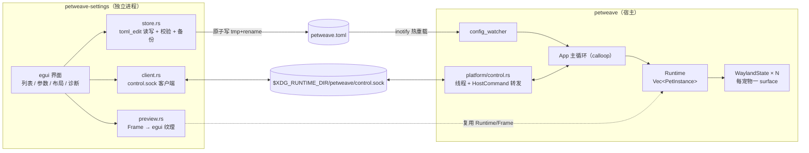

# PetWeave 图形设置界面（GUI）实现计划

本轮评审补充（详见 [REVIEW.md](REVIEW.md)）：
- [x] 颜色选择器拒绝非 ASCII 十六进制字符串，避免 UTF-8 切片崩溃。
- [x] 预览仅在首帧/画面变化时更新纹理，静止帧复用已有纹理；已补无窗口回归测试。
- [x] workspace 共 196 项测试通过；实际桌面 CPU 改善尚未复测。

> **文档定位**：本文是 GUI 子系统的**增量式路线图**，不是一次性定稿的设计书。
> 实现过程中每推进一步就勾选任务、更新 §14 进度看板、把新发现写进 §13 待定问题；
> 决策变更走 §2 的决策记录（追加新条目，不删旧条目）。
>
> 相关文档：[ROADMAP.md](ROADMAP.md)（总里程碑）· [ARCHITECTURE.md](ARCHITECTURE.md)（现有架构）·
> [TECH_STACK.md](TECH_STACK.md)（技术选型，§4.10 已预留 egui 设置面板）· [PACKAGES.md](PACKAGES.md)
>
> 状态图例：`✅ 完成` · `🔶 进行中` · `⬜ 未开始` · `⏸ 暂缓`
> 版本：v0.8（G0/G1/G2/G3 已落地并在 niri 实测通过）· 最后更新：2026-10-22

---

## 1. 目标与非目标

### 1.1 目标

1. **多宠物管理**：在一个界面里增删宠物、启用/禁用、调整顺序，同一角色包可开多个实例。
2. **参数可视编辑**：按宠物 `kind` 生成表单（BongoCat / demo / sprite / lua），替代手写 TOML。
3. **布局可视化**：既能用 anchor + margin 表单精确定位，也能在按显示器分页的画布上拖拽摆放（吸附 8px 网格与边/中心线）。
4. **实时预览**：列表内缩略图 + 单宠物动画预览，用与宿主**完全相同**的软渲染路径，所见即所得。
5. **保存即生效**：复用现有 300ms 去抖热重载；无法热生效的项（`kind`/`package`/`output` 变更）明确提示需要重建。
6. **零宿主负担**：GUI 是独立 crate + 独立二进制，宿主二进制**不新增任何 GUI 依赖**，5MB / 0% CPU 基线不变。

### 1.2 非目标（明确不做）

- ❌ 不做"宠物商店"的联网下载（签名与商店在 M2 遗留项，另行规划）。
- ❌ 不把 egui 链进 `petweave` 主二进制（不做 `feature = "gui"` 的进程内面板）。
- ❌ 不做 Live2D 模型参数调音台（M4 Live2D 落地后另开文档）。
- ❌ v1 不做远程控制（HTTP / 跨机器）；控制通道仅本机 `XDG_RUNTIME_DIR`。
- ❌ 不承诺在 GNOME/Mutter 上可用（宿主本身是受限模式，GUI 继承该限制）。

---

## 2. 决策记录（ADR）

| # | 决策 | 理由 | 可逆性 |
|---|---|---|---|
| D1 | UI 框架用 **egui + eframe** | 纯 Rust、无 GTK/Qt/WebView 运行时；立即模式写表单/预览/拖拽画布最快；与项目"自绘、轻量"的定位一致 | 中：UI 层集中在 `crates/petweave-settings`，换框架不影响宿主与协议 |
| D2 | GUI **独立 crate + 独立二进制** `petweave-settings` | 宿主保持零 GUI 依赖；两套事件循环（calloop 与 winit）互不干扰；GUI 崩溃不影响宠物 | 低：进程边界一旦定下，回退到进程内需要重做事件循环整合 |
| D3 | 先做**多宠物运行时**，再做 GUI | 配置 `[[pets]]` + 每宠物一 surface 是列表/画布的地基；顺序颠倒会产出只能编辑单宠物的半成品并返工 | 低（依赖关系） |
| D4 | 布局编辑 = **表单（anchor+margin）+ 画布拖拽** 两者都要 | 表单便于精确定位与脚本化；画布覆盖"拖到哪儿算哪儿"的多数需求 | 高 |
| D5 | GUI 与宿主通过 **Unix socket + JSON Lines** 通信 | 需要拿到每只宠物真实 surface 位置/尺寸、动态增删；该消息风格可被 M4"外部宠物进程协议"复用 | 中：协议版本化，v1 只读 + 少量写操作 |
| D6 | 配置写入用 **`toml_edit`** 而非 `toml::to_string` | 保留用户注释、键顺序与未知键；避免"GUI 存一次盘，注释全没"的经典事故 | 高 |
| D7 | 复用渲染：给宿主 crate 增加 **`src/lib.rs`**，GUI 依赖其 `runtime/graphics/package` | 预览与宿主走同一份代码，避免两套渲染逻辑漂移（不再 spawn `--preview` 子进程） | 高 |
| D8 | GUI crate **单独声明 `rust-version`**（egui 0.37 需 1.95），宿主保持 1.80 | 不必为设置面板抬升整个 workspace 的 MSRV | 高 |
| D9 | 中文字体用 **`fontdb` 扫描系统字体**注入 egui | `fontdb` 已在依赖树（resvg→usvg→fontdb 0.23），零新增依赖即可拿到 Noto Sans CJK | 高 |
| D10 | 宿主**不写配置**（唯一写者是 GUI 与 CLI 迁移命令） | 避免双向写导致的互相覆盖；宿主只读 + 热重载 | 高 |
| D11 | 宠物实例用稳定 **`id`** 标识（而非数组下标） | 重命名/排序/多实例下，控制通道与 Lua storage 需要稳定键 | 中 |
| D12 | G2 渲染后端先只开 **`glow`**；`wgpu` 回退延后到 G4 | eframe 0.37 的默认 feature 实际是 wgpu，编译单元与体积都大得多；glow 已覆盖 niri/主流 Mesa。N04 的 wgpu 回退在打包阶段补，协议/UI 不受影响 | 高：eframe feature 只影响 GUI crate |

---

## 3. 总体架构



**两条生效路径**（并存，各管一段）：

| 路径 | 用途 | 延迟 |
|---|---|---|
| 写配置文件 → inotify 热重载 | 参数持久化、布局持久化（GUI 的"保存"按钮） | 300ms 去抖后 |
| control.sock 直接命令 | 画布拖拽的即时反馈、显隐/移动模式、读取真实位置、动态增删 | <10ms |

设计原则与 [ARCHITECTURE.md](ARCHITECTURE.md) §10 一致：**所有 Wayland 与宠物状态变更都发生在宿主主线程**。控制线程只解析请求，通过 `HostCommand::Control{..}` 投递给主循环，主循环应用后经 oneshot 通道回包。

---

## 4. 技术栈与依赖

### 4.1 依赖清单

| 依赖 | 版本（起点） | 用途 | 备注 |
|---|---|---|---|
| `eframe` | 0.37（MSRV 1.95） | 窗口 + 事件循环 + 渲染器 | 0.37 的默认 feature 是 **wgpu**；本实现显式改用 `glow`（体积/编译时间小），wgpu 回退（N04）留到 G4 打包时再开 |
| `egui` | 0.37 | 控件、布局、绘图 | 与 eframe 同版本锁定 |
| `egui_extras` | 0.37 | 表格、`Image` 缩放 | **G2 未引入**：宠物列表用 `egui::Grid` 已足够；需要表格/图片加载时再加 |
| `fontdb` | 0.23 | 找系统中文字体 | 已在依赖树（不新增编译单元） |
| `toml_edit` | 0.22 | 保注释的配置编辑 | 新增 |
| `petweave`（宿主 lib） | path | `runtime`/`graphics`/`package`/`platform::control` | D7：预览与协议复用同一份代码；代价是 GUI 二元体积（G3 实测 15.03 MiB） |
| `petweave-core` | path | `Config` / `Manifest` / `Frame` / 校验 | 单一事实来源 |
| `serde` / `serde_json` | workspace | 控制协议报文 | 复用现有版本 |
| `anyhow` / `tracing` | workspace | 错误与日志 | 复用 |
| `egui_kittest`（dev） | 与 egui 同版 | 无头 UI 测试 | 仅测试依赖 |

**不引入**：GTK / Qt / WebKitGTK / Tauri / `tray-icon`。托盘仍由宿主的 `ksni` 负责。

### 4.2 版本与 MSRV 策略

```toml
# crates/petweave-settings/Cargo.toml
[package]
name = "petweave-settings"
rust-version = "1.95"   # 覆盖 workspace 的 1.80，只影响 GUI crate
```

`eframe` 用的是 winit → 在 Wayland 上创建普通 `xdg_toplevel` 窗口，与宿主的 `wlr-layer-shell` surface 分属两个进程、两条连接，**不存在协议冲突**。
在 niri 这类滚动平铺合成器上设置窗口会被平铺，需在文档里给一条窗口规则示例（浮动/居中）。

### 4.3 二进制与入口

| 入口 | 行为 |
|---|---|
| `petweave-settings` | 直接启动 GUI；`--config <path>` 指定配置文件；`--socket <path>` 指定控制 socket |
| `petweave settings` | 在 `PATH` / 同目录查找 `petweave-settings` 并 `exec`；找不到时提示安装方式 |
| 托盘「设置…」 | 与 `petweave settings` 相同（宿主 spawn 子进程） |

GUI 在宿主未运行时**仍可用**：只做配置读写，顶部横幅提示"宠物未运行，保存后下次启动生效"，控制相关按钮置灰。

---

## 5. 配置 v2：`[[pets]]` 多宠物

### 5.1 目标形状

```toml
[general]
fps = 60
log_level = "info"
sysinfo_interval_secs = 5
tray_enabled = true

[input]
enabled = true
auto_detect = true
devices = []
scan_interval_secs = 30

# 全局默认值：[[pets]] 未写出的字段从这里继承（沿用既有 [render] 节名）
[render]
width = 256
height = 256
layer = "top"
anchor = "bottom"
margin_top = 16
margin_right = 0
margin_bottom = 16
margin_left = 0
output = ""
disable_fullscreen_hide = false
click_through = true
mode = "physics"

[[pets]]
id = "bongo-main"          # 稳定实例 ID（缺省由宿主按序号生成）
name = "BongoCat"          # 展示名（也用于日志）
enabled = true
kind = "bongo"
width = 0                  # 0 / 缺省 = 用宠物 preferred_size
height = 0
anchor = "bottom"
margin_bottom = 16
mode = "physics"           # 与 [render].mode 同名；move_mode 作为别名接受，写回时统一为 mode

[pets.bongo]
cat_height = 200
keypress_duration_ms = 100
hand_mapping = true
mirror_x = false
idle_sleep_timeout_secs = 300
enable_scheduled_sleep = false
sleep_begin = "22:00"
sleep_end = "06:00"

[[pets]]
id = "blinky-1"
name = "Blinky"
enabled = true
kind = "sprite"
package = "blinky"
anchor = "bottom|left"
margin_left = 64
margin_bottom = 32

[[pets]]
id = "lua-demo-1"
name = "Lua 气泡"
enabled = true
kind = "lua"
package = "lua-demo"
anchor = "top|right"
margin_top = 40
margin_right = 40
click_through = false
```

### 5.2 解析与继承规则（必须与代码一致）

1. `[render]` = 全局默认值；`[[pets]]` 的每个字段都是 `Option<T>`，`None` 时继承默认值。
2. 字段名与 `[render]` **同名同义**：`width/height/layer/anchor/margin_*/output/disable_fullscreen_hide/click_through`。
3. 移动模式：`[[pets]].mode`（新键）优先；未写时用 `[render].mode`；`[render].mode` 为空时回退旧 `[render].physics` 布尔（保持与现状 `MoveMode` 解析一致）。为兼容，`[[pets]].move_mode` 作为 `mode` 的别名接受，写回时统一写 `mode`。
4. 尺寸（v0.3 定案，Q1A/Q2A/Q9）：**显式 `[[pets]].width/height` 优先**，其次宠物
   `preferred_size()`，再次 `[render]` 默认值；`0` 或缺省 = 继承下一级。
   - 只写一边时，另一边按宠物原图比例推算（`scaled_for`）；两边都写时宠物内容按比例缩放进盒子
     （`scale_to_fit`），**永不拉伸变形**。
   - 实现：`petweave_core::pet::resolve_surface_size` / `scaled_for` / `scale_to_fit`，
     `Pet::surface_size` + `Pet::resize_to`。GUI 改尺寸 = 改这两个键，宿主热重载后
     `Runtime::fit_frames` / `tick_all` 会把渲染帧与图片一起缩放。
   - 运行时即时反馈走控制通道 `SetSize`（§6.3），不写盘。
5. `id`：写配置时可选；缺省按 `"{kind}-{序号}"` 生成并回填到内存（`petweave config migrate` 会补写）。
6. `enabled = false` 的宠物不建 surface，但保留在配置里（GUI 里是"已停用"分组）。

### 5.3 向后兼容与迁移

- 只读兼容：文件里只有 `[pet]`/`[pet.bongo]`、没有 `[[pets]]` 时，视为单元素列表（`id = "default"`），并 `warn!` 一条"建议迁移"日志。
- 同时存在 `[[pets]]` 与 `[pet]`：以 `[[pets]]` 为准，`[pet]` 忽略 + `warn!`。
- 显式迁移：新增子命令 `petweave config migrate [-c path] [--write]`，把旧格式改写为 `[[pets]]`（保留注释），`--write` 前先备份。
- GUI 首次保存时自动完成迁移，并在界面提示"配置已升级为多宠物格式"。
- 过渡期：至少保留两个 minor 版本的双读兼容，之后在 CHANGELOG 标注移除。

### 5.4 校验规则（扩展 `Config::validate`）

| 规则 | 错误信息要点 |
|---|---|
| `pets.len() <= 12` | 宠物数量上限（保护合成器与内存） |
| `id` 非空且唯一 | 重复 id 会破坏控制协议寻址 |
| `name` 非空 | 日志与托盘菜单展示 |
| `kind ∈ {demo,bongo,sprite,lua}` | 与现状一致 |
| `kind ∈ {sprite,lua}` ⇒ `package` 非空 | 与现状一致；GUI 侧提供下拉选择已安装包 |
| `width/height ∈ 1..=4096`（0 = 自动） | 与现状一致 |
| `layer ∈ {background,bottom,top,overlay}` | 与现状一致 |
| `mode ∈ {drag,physics,fixed}`（空 = 继承） | 与现状一致 |
| `margin_* ∈ -8192..=8192` | 允许负 margin 贴边 |
| `bongo.cat_height ∈ 10..=500`；`sleep_*` 为 `HH:MM` | 与现状一致 |

> GUI **直接调用** `petweave_core::Config::validate()`，不在 UI 层另写一份规则；表单只负责把字段值映射为结构体。

### 5.5 写入策略（GUI 侧）

1. 读取原文件为 `DocumentMut`（`toml_edit`）。
2. 只改动 `[[pets]]` / `[render]` / 必要时 `[general]` 等目标节，未触及的行保持原样（注释、空行、顺序）。
3. 写盘前先 `parse` 回 `Config` 并 `validate()`，失败则**不写盘**、表单里标红。
4. 原子写：同目录 `petweave.toml.tmp-<pid>` → `fsync` → `rename`；旧文件先复制为 `petweave.toml.bak`（保留一份）。
5. 文件权限 `0600`（配置里将来会有 AI key 等敏感项）。
6. 写在 GUI 线程做（文件很小，<1ms 级），写完调用 `Reload` 加速生效（不依赖 300ms 去抖）。
7. **三方合并（最小版）**：`Store` 记住加载/上次保存时的文件文本；保存前若磁盘内容已变，
   拒绝写入并提示「配置文件已被其他程序修改」，GUI 提供「重新加载」而不是静默覆盖。

---

## 6. 控制通道协议（control.sock v1）

### 6.1 传输与安全

- 路径：`${XDG_RUNTIME_DIR}/petweave/control.sock`；目录 `0700`，socket `0600`。
- `XDG_RUNTIME_DIR` 缺失时**不启用**控制通道（日志 warn，GUI 降级为纯配置编辑）。
- 帧格式：**JSON Lines**（一行一个 JSON 对象，`\n` 结尾），单行上限 64 KiB，超限断开。
- 鉴权：依赖文件系统权限；v1 不做 token（同用户即可控制，与本机 `$XDG_RUNTIME_DIR` 的信任模型一致）。

### 6.2 报文封装

```jsonc
// 请求
{"id": 7, "op": "SetPlacement", "pet": "bongo-main", "anchor": "bottom", "margins": [0,0,16,0]}
// 成功响应
{"id": 7, "ok": true, "data": {"rect": [812, 640, 264, 110]}}
// 失败响应
{"id": 7, "ok": false, "error": {"code": "pet_not_found", "message": "no pet with id 'x'"}}
// 主动事件（无 id）
{"event": "PetMoved", "pet": "bongo-main", "rect": [812, 640, 264, 110]}
```

### 6.3 操作表

| op | 请求字段 | 响应 `data` | 触发主循环动作 |
|---|---|---|---|
| `Hello` | `protocol`, `client` | `server`, `protocol`, `pid`, `caps` | — |
| `ListPets` | — | `[{id,name,kind,package,enabled,visible,size,rect,preferred_size,natural_size,size_owner,output,layer,mode,error?}]` | 读快照（`size_owner` = `config`/`pet`/`script`，GUI 据此提示"尺寸由宠物决定"） |
| `ListOutputs` | — | `[{name,x,y,w,h,scale}]` | 读 `xdg-output` 快照 |
| `Reload` | 可选 `pets`（内联补丁：拖动参数滑杆时的即时预览，不写盘） | `{reloaded, added, removed}` | `HostCommand::ReloadConfig` 或原地 patch |
| `SetPlacement` | `pet`, `anchor`, `margins[4]` | `{rect}` | 立即改 margin/anchor |
| `SetSize` | `pet`, `width`, `height`（0 = 按原图比例推算另一边） | `{rect}` | 缩放 surface + 内容（等比），供画布拉伸/滑杆即时反馈 |
| `SetVisible` | 可选 `pet`（缺省=全部）, `visible` | `{}` | 显隐 |
| `SetMoveMode` | 可选 `pet`, `mode` | `{}` | `set_move_mode` |
| `SetPaused` | `paused` | `{}` | 暂停 tick（省电/调试） |
| `RenderPet` | `pet`, `width`, `height` | `{rgba_base64}` | 宿主渲染当前帧（GUI 无法本地加载包时的兜底） |
| `Quit` | — | `{}` | `HostCommand::Quit` |

事件（宿主 → GUI）：

| event | 字段 | 说明 |
|---|---|---|
| `PetsChanged` | `pets: [...]` | 增删/启用变更后广播 |
| `PetMoved` | `pet`, `rect` | 用户拖拽宠物或物理落定后广播 |
| `Status` | `fps`, `rss_kb`, `pets` | 5s 一次（诊断页用） |
| `Error` | `code`, `message` | 运行时错误（包加载失败等） |

### 6.4 版本协商

`Hello.protocol = 1`；宿主 `caps` 形如 `{"protocol":1,"placement":true,"size":true,"events":true,"reload_patch":true,"preview":false}`。
版本不匹配时：宿主回 `error.code = "protocol_mismatch"`，GUI 显示"设置面板与宠物进程版本不一致，请一起升级"，并**只允许**配置编辑。

### 6.5 实现说明（G1 已落地）

实现：`crates/petweave/src/platform/control.rs`（协议类型 + socket 服务 + 白盒测试），
主循环侧在 `App::handle_control`。与上文草案的差异/补充：

- **运行期只读不写盘**：`SetPlacement` / `SetSize` / `SetVisible` / `SetMoveMode` /
  `SetPaused` 只改运行状态（D10：宿主不写配置）；GUI 负责把最终值写进 TOML。
  `Reload` 不带 `pets` = 重读磁盘；带 `pets` = 把补丁应用到内存配置后 `apply_config`，
  **同样不落盘**（滑杆预览用），下一次磁盘重载会回到文件值。
- `RenderPet` 暂未实现，返回 `error.code = "unsupported"`，`caps.preview = false`；
  GUI 预览按 D7 本地复用 `petweave` 的 `runtime` 渲染（G2/G3）。
- 事件：`PetsChanged` 在任何宠物集合/参数/显隐/移动模式/层级变化后广播（含热重载）；
  `PetMoved` 在拖拽/物理移动时限流 ~20Hz，并在全部宠物静止后补发最后一帧；
  `Status` 每 5s 一次，`{fps: 目标帧率, rss_kb, pets: 运行中数量}`。
- `ListPets[].size_owner` 取值 `config`（显式 `[[pets]].width/height`）/ `pet`
  （`preferred_size`）/ `script`（Lua 脚本自定尺寸）/ `default`（回退 `[render]`）；
  `rect` 对未运行的宠物也按配置推算，便于 GUI 列表布局。
- `Quit` 先把响应写回客户端，主循环最多等 100ms 再退出，避免"命令成功但连接先断"。
- 错误码：`bad_json` / `bad_request` / `unknown_op` / `line_too_long` /
  `protocol_mismatch` / `pet_not_found` / `invalid_argument` / `internal` /
  `reload_failed` / `unsupported`。
- 响应与事件的到达顺序**不保证**：`PetsChanged` 可能先于本次请求的响应到达同一连接
  （客户端必须按 `id` 匹配响应，忽略或排队 `event` 报文，参考 `petweave control` 客户端）。
- 权限：目录 0700、socket 0600，无 token（同用户信任模型）；`XDG_RUNTIME_DIR`
  缺失/不可绑定时只告警并禁用，宿主照常运行。
- 调试客户端：`petweave control '<json>' [--socket PATH]` 做一次 JSON Lines 往返，
  跳过主动事件后打印响应（见 README 子命令）。

---

## 7. 界面信息架构

```
┌──────────────────────────────────────────────────────────────┐
│ PetWeave 设置        [宿主：已连接 ●]      [保存并应用] [⋯]    │
├──────────┬───────────────────────────────────────────────────┤
│ 宠物     │  宠物列表                                          │
│  ├ 列表  │  ┌────┬────────┬────────┬──────┬──────┬─────────┐ │
│  ├ 参数  │  │图标│ 名字   │ 类型   │ 状态 │ 位置 │ 操作    │ │
│  ├ 布局  │  ├────┼────────┼────────┼──────┼──────┼─────────┤ │
│  ├ 诊断  │  │🐱  │ Bongo  │ bongo  │ 显示 │ 底部 │ ⚙ 复制 ✕│ │
│  └ 关于  │  │🟣  │ Blinky │ sprite │ 显示 │ 左底 │ ⚙ 复制 ✕│ │
│          │  └────┴────────┴────────┴──────┴──────┴─────────┘ │
│          │  [+ 添加宠物 ▾]（从已安装角色包 / 内置类型）        │
└──────────┴───────────────────────────────────────────────────┘
```

| 页面 | 内容 |
|---|---|
| **宠物列表** | TableBuilder：缩略图、名字、`kind`/包名、启用开关、位置摘要、复制/删除/排序（拖拽或上下按钮）；底部"+ 添加宠物"下拉（内置 demo/bongo + `package::list()` 结果 + 清空后的包管理入口） |
| **参数** | 左侧三列分组表单：通用（名字/尺寸/帧率/点击穿透/移动模式/层级/显示器）、按 kind（bongo 睡眠与爪击；demo 颜色；sprite/lua 包与脚本）；每项带默认值提示（"继承自 [render]"）与"恢复默认"按钮 |
| **布局**（G3 ✅） | 上半：按显示器分页的画布，画布上画输出矩形 + 每只宠物（贴真实 rect，画宠物自身缩略图），可拖动、8px 吸附、边/中心线吸附；下半：选中宠物的 anchor 复选 + 四边 margin 数值框，两边双向同步，含「放到底部居中」「恢复默认位置」预设 |
| **诊断**（G4） | 内嵌 `doctor`：会话/Wayland、layer-shell 可用性、输入权限与已发现设备、字体（是否找到 CJK）、包仓库路径、版本与协议号；`--apply` 类操作 v1 只显示命令不执行 |
| **关于** | 版本、配置文件路径、socket 路径、日志位置、`--validate-config` 结果、协议版本 |

交互细节：

- **脏状态**：与"上次保存快照"比较（解析后的 `Config` 结构比较），而非逐字段 dirty 标记；切换页签/关闭窗口时若有未保存改动 → 确认弹窗。
- **保存并应用** → §5.5 写盘 → `Reload` → 等 `PetsChanged` → 清脏状态；失败保留脏状态并显示错误。
- **画布拖拽** → 立刻 `SetPlacement`（响应里带新 `rect`，即时反馈）→ 松手写配置（持久化）。
  用户直接拖动桌面宠物、物理落定等宿主侧位移由 `PetMoved` 事件回流，避免 GUI 与真实位置漂移。
- **预览**（G3 ✅）：列表缩略图 + 参数页右上角动画预览 + 画布上的宠物图；都走 `runtime` + `Frame` → `ColorImage`（D7），
  约 10fps（`PREVIEW_INTERVAL`），且只有显示预览的页签才跑；纹理按 `(pet id, 像素上限, 帧序号)` 缓存，
  `Runtime` 只在 kind/包/尺寸/颜色等"会改变像素"的字段变化时重建（改名字不重建）。
- **字体与主题**：跟随系统深浅色；`fontdb` 优先匹配 `Noto Sans CJK SC` → `Source Han Sans` → `WenQuanYi`；找不到时界面仍可用但提示"中文显示可能异常"。
- **HiDPI**：`ViewportBuilder::with_title` + 由 eframe 自动处理 `pixels_per_point`；画布坐标一律用**逻辑像素**，与宿主 margin 语义一致。

---

## 8. 需求清单

优先级：**P0 = G0–G2 必须**，**P1 = G3**，**P2 = 可延后**。

### 8.1 配置与运行时（宿主侧）

| ID | 需求 | 优先级 | 验收 |
|---|---|---|---|
| F01 | `[[pets]]` 数组配置 + `[render]` 默认值继承 + `Option` 语义 | P0 | 手写三宠物配置，宿主同时显示三只 |
| F02 | 旧 `[pet]` 单表自动兼容 + `petweave config migrate` | P0 | 旧配置直接可跑；migrate 后仍是同样行为且注释保留 |
| F03 | 每宠物独立 surface（共享 Wayland 连接与资产缓存） | P0 | 两只 BongoCat + 一只 blinky 同屏，各自独立拖拽/物理/点击穿透 |
| F04 | 运行中增删宠物（不重启进程） | P0 | GUI 加一只 blinky，1s 内出现在桌面；删除后 surface 干净消失（无残影） |
| F05 | 每宠物独立 placement（anchor/margins/output/layer/mode） | P0 | 两只宠物分别定位到两个显示器、不同 layer |
| F06 | 宠物数量上限与资源保护（≤12，超限校验报错） | P1 | 第 13 只被拒绝且提示清晰 |

### 8.2 设置面板：宠物与参数

| ID | 需求 | 优先级 | 验收 |
|---|---|---|---|
| F10 | 宠物列表（缩略图/名字/类型/启用/位置/复制/删除/排序） | P0 | 复制一只 BongoCat 生成 `bongo-2`，参数独立 |
| F11 | 从已安装包添加宠物（`package::list()` + 内置类型） | P0 | 安装 `blinky` 后能在下拉里添加两只 blinky |
| F12 | 通用参数表单（名字/尺寸/帧率/click_through/mode/layer/output） | P0 | 改 `click_through` 后宿主行为立即变化 |
| F13 | 按 kind 的参数表单（bongo 全套 / demo 颜色 / sprite·lua 包与脚本展示） | P0 | bongo 的 `cat_height` 滑杆拖动时预览与桌面同步缩放 |
| F14 | 校验内联提示 + 保存前阻断（调 `Config::validate`） | P0 | 非法 `sleep_begin` 无法保存，字段标红并给原因 |
| F15 | 参数"继承默认值"显示与"恢复默认" | P1 | 未写出的字段提示"来自 [render]"，一键恢复后写出的键被删除 |

### 8.3 布局

| ID | 需求 | 优先级 | 验收 |
|---|---|---|---|
| F20 | 表单模式：anchor 复选 + 四边 margin（含负值） | P0 | 与手写 TOML 等价，保存后位置一致 |
| F21 | 画布：按显示器分页、画出输出与宠物真实 rect | P1 | 宠物拖动后画布即时跟随；显示器拔插后重新枚举 |
| F22 | 画布拖拽 → 实时 `SetPlacement` + 落定写配置 | P1 | 拖拽过程中桌面上的宠物跟手（≤50ms 感知延迟） |
| F23 | 吸附：8px 网格、边/中心线，可关 | P1 | 拖到接近底部时自动吸附到"底部居中" |
| F24 | 预设"放到底部居中 / 恢复默认位置" | P1 | 一键后配置里只剩必要键 |

### 8.4 预览与生效

| ID | 需求 | 优先级 | 验收 |
|---|---|---|---|
| F30 | 列表缩略图 + 参数页动画预览（复用 `runtime`/`Frame`） | P1 | 与桌面显示同帧（含睡眠帧、气泡），无第二套渲染代码 |
| F31 | 保存即热重载，且提示需重建的项 | P0 | `kind`/`package` 变更自动重建实例、`width/height` 触发素材等比缩放、`output` 自动重绑；GUI 保存后立即 `Reload`，未连接时在握手后补发 |
| F32 | 原子写 + `.bak` + 保注释 + 0600 | P0 | 手工在 TOML 写的注释在多次保存后仍存在；断电/写失败不会留半截文件 |
| F33 | 宿主离线可编辑 | P0 | 不启动 `petweave` 时 GUI 正常打开、保存、校验通过 |
| F34 | 关闭 GUI 不影响宠物运行 | P0 | `kill` GUI 后桌面宠物继续动画 |

### 8.5 诊断与集成

| ID | 需求 | 优先级 | 验收 |
|---|---|---|---|
| F40 | 诊断页（会话/layer-shell/输入权限/字体/包仓库/版本协议） | P1 | 复现 `petweave doctor` 的信息，且不要求终端 |
| F41 | 托盘「设置…」+ `petweave settings` 入口 | P1 | 托盘点开 GUI；无 GUI 二进制时给出安装提示 |
| F42 | 包管理（安装/卸载/打包/导入 XPM）放 GUI | P2 | 拖入 `.petweave` 即安装并出现在列表 |
| F43 | 多语言（中文优先，英文字符串表预留） | P2 | UI 文案集中管理，无硬编码散落 |

### 8.6 非功能

| ID | 需求 | 验收 |
|---|---|---|
| N01 | 宿主二进制体积/依赖不因 GUI 变化 | `cargo tree -p petweave` 无 egui/eframe；release 体积与 M3 基线差异 <1% |
| N02 | 宿主内存基线不回退 | 单宠物空闲 RSS ≤ 6MB（与 M3 实测 5.7MB 同量级） |
| N03 | GUI 崩溃不影响宿主；宿主崩溃 GUI 显示"已断开"并可重连 | 杀进程测试 |
| N04 | GL 不可用时回退 wgpu，仍失败给明确指引（`--renderer wgpu`） | 在软件 GL/无 GPU 环境启动不 panic |
| N05 | 控制协议有版本协商，旧 GUI 连新宿主不静默错乱 | 伪造协议号测试 |
| N06 | 文档同步：README「设置界面」+ ARCHITECTURE 数据流 + 本文勾选 | PR 检查项 |

---

## 9. 里程碑

> 每个里程碑都以"可演示 + 可测试"为准入；估算为参考人日，不承诺排期。

### G0 · 多宠物运行时与配置 v2 ✅ 完成

- [x] `petweave-core`：新增 `PetInstance` / `ResolvedRender` / `ResolvedPet`，`Config.pets: Vec<PetInstance>`（`Option` 字段继承 `[render]` + `PetInstance::resolve()` / `Config::resolve_pets()` / `enabled_pets()` / `pet_by_id()`）
- [x] 兼容：`[pet]` → 单元素列表（`id = "default"`，`legacy_pet` 标志 + `warn!`/`info!` 提示）；`[render].physics` → `mode` 回退逻辑保持；两者并存时 `[[pets]]` 胜出
- [x] 校验：`Config::validate` 覆盖 §5.4 全部规则（id 自动生成 + 唯一、数量上限 12、name 非空、kind/package/layer/mode/margin/cat_height/sleep 范围；`mode` 与 `move_mode` 冲突报错）
- [x] `default_config_path()` / `config_file_path()` 上移到 `petweave-core::config`（GUI 复用）
- [x] CLI：`petweave config migrate [--write]`（`toml_edit` 保注释 + `.bak` + 原子写 + 0600）、`--preview --pet-id <id>`；`doctor` 逐宠物体检；`--width/--height/--pet` 作用于第一只
- [x] 宿主：`Runtime` 按 `[[pets]]` 装载 N 个宠物（`Slot` 含每宠物 `Frame`）；`WaylandState` 拆成"共享连接 + `PetSurface` ×N"，每 surface 独立 SHM 双缓冲 / buffer_scale / anchor+margin / input region；拖拽/物理/显隐/全屏隐藏/移动模式按宠物独立
- [x] 热重载：`Runtime::apply` 返回 `ReloadOutcome{added,removed,recreated,resized,updated}`；surface 按 diff 创建/销毁，换 `kind` 重建，改 `output` 重绑，纯参数原地 `apply_props`
- [x] 资产缓存（Q1）：`runtime::assets::AssetCache` 以 `(path, w, h)` 为 key 共享 `Arc<Frame>`，同尺寸两只 BongoCat 只解码一次（实测 5 decoded / 5 hit），宠物移除后 `collect()` 回收
- [x] 托盘：多宠物子菜单（每宠物显隐 + 移动模式）、全局「显示/隐藏全部」「移动模式（全部）」，标题随状态更新
- [x] 测试：core 35 项（迁移/继承优先级/id 唯一/数量上限/margin 范围/`[pet]` 兼容/`[[pets]]` 胜出/`mode` 别名）+ 宿主 63 项（placement 反算 round-trip、多宠物装载/增删/换 kind/尺寸、独立物理、双 BongoCat 共享资产、托盘菜单）；共 **98 项全绿**（G0 当时）
- 验收：✅ 三宠物同屏（2×BongoCat + sprite）在 niri 实测：三块独立 SHM（scale 1.5 → 物理 ×2）、各自 anchor/click_through/mode；热重载 300ms 内完成增删/重建/重配置；旧 `[pet]` 配置零改动可跑并通过 `config migrate` 无损升级

### G1 · 控制通道 ✅ 完成

- [x] `platform/control.rs`：socket 监听线程 + JSON Lines 解析 + 每请求回包
      （每连接一个 reader + writer 线程，主线程只投递 `ControlCall`，客户端慢不会卡宿主）
- [x] `HostCommand::Control(..)` 进入主循环，所有变更在主线程应用
- [x] 实现 §6.3 的 `Hello` / `ListPets` / `ListOutputs` / `Reload`（含内存补丁）/
      `SetPlacement` / `SetSize` / `SetVisible` / `SetMoveMode` / `SetPaused` / `Quit` 与
      `PetsChanged` / `PetMoved` / `Status` 事件；`RenderPet` 延后（返回 `unsupported`，
      `caps.preview=false`）
- [x] 权限：目录 0700 / socket 0600；`XDG_RUNTIME_DIR` 缺失时告警并禁用
- [x] 协议单测 9 项：golden 报文、未知 op、坏 JSON、响应/事件形状、版本不匹配、
      超长行（64 KiB）、socket 权限、端到端往返 + 事件广播 + 断连清理
- [x] `petweave control '<json>'` 调试客户端（README 已记录）
- 验收：✅ 在 niri 实测：两只 demo 宠物 `ListPets` 拿到真实 rect
  （`[822,987,64,64]` / `[64,971,64,64]`，eDP-1 scale 2），`SetPlacement` 移到
  `top|left` 后 rect 变 `[30,20,64,64]`，`SetSize` 128 等比缩放、
  `SetVisible`/`SetMoveMode`/`SetPaused`/`Reload`（磁盘与补丁）/`Quit` 全部生效；
  `Hello protocol=99` 返回 `protocol_mismatch`，未知 op 返回 `unknown_op`，
  socket 实际权限为 `drwx------` + `srw-------`

### G2 · 设置面板 MVP ✅ 完成

- [x] `crates/petweave-settings` 骨架：eframe 窗口、`Panel` 侧栏路由、深浅色跟随、CJK 字体注入
      （`fonts.rs` 用 `fontdb` 找 Noto/Source Han/WenQuanYi，失败时界面仍可用并提示）
- [x] `store.rs`：`DocumentMut` 读写、**逐键更新保注释**、`[[pets]]` 增删/重排、原子写 + `.bak` + 0600、
      保存前 `Config::validate` + 回读比对、旧 `[pet]` 自动迁移、外部修改检测
- [x] `client.rs`：非阻塞 Unix socket、2s 重连、`Hello` 握手/协议不匹配降级、事件与快照解析
- [x] 列表页（F10/F11：表格、启用/停用、上移/下移/复制/删除、内置类型 + 已安装包添加）
      + 参数页（F12/F13/F14/F15：通用/按 kind 表单、继承提示与「恢复默认」、内联校验）
      + 保存并应用（F31/F32/F33/F34：立即 `Reload`、原子写、断网可编辑、关 GUI 不影响宿主）
- [x] `petweave settings` 入口（同目录或 PATH 查找 `petweave-settings`，缺失时给出构建/安装提示）
- [x] UI 测试：`egui_kittest` 覆盖"改字段 → 脏 → 保存 → 文件内容含注释"（headless，无 GPU）
- [x] 测试：settings 库 21 项（store 11 + client 4 + app 6）+ 集成 4 项（store→host 热重载 2 + `egui_kittest` UI 2：保存与继承）
- 验收：✅ 设置在 niri 启动成功（窗口标题 `PetWeave 设置`、进程常驻）；
  "加包/改高度/删除"由列表/参数页 + 保存路径实现，保存→注释保留→回读校验由 kittest 与 store 测试覆盖
- 热重载语义（G2 修复）：
  - `kind` 或 **`package`** 变更 → 重建宠物实例（此前只调 `Pet::reload`，sprite/lua 不会换包）；
  - `width/height` 变更 → `resize_to` 把素材等比缩放进新盒子（BongoCat 此前只改透明 surface、猫本身大小不变）；
  - **删除** `width/height`（GUI「继承」）→ 回到宠物固有尺寸；sprite/lua 的 layout resize 不再覆盖
    `preferred_size`（此前会在删除配置后仍沿用上次缩放出的盒子，表现为"继承保存不变化"）；
  - `output` 变更 → 重建/重绑 surface；其余参数原地应用。
  - GUI 保存时若控制通道尚未握手，会记住并在连接后补发 `Reload`，同时状态栏明确提示"宿主未连接"。
- 已知边界：
  - 渲染后端仅 `glow`；`wgpu` 回退与 `--renderer` 放 G4（N04 暂未满足）。
  - 布局画布/缩略图预览仍是 G3；诊断页仍是 G4。
  - 完整手工验收（鼠标点选三只宠物）建议在真实桌面上再走一遍；自动化已覆盖同等路径。

### G3 · 布局画布与实时预览 ✅ 完成（2026-10-22 niri 实测通过）

- [x] `canvas.rs`：**纯函数**几何层 —— `CanvasMap`（输出逻辑像素 ↔ 画布屏幕像素，等比 letterbox 且可逆）、
      `snap_axis`/`snap_move`（8px 网格 + 显示器左/右/上/下边 + 中心线，阈值 6px；边/中心优先于网格）、
      `pet_rect`（anchor+margin → rect，复用 `petweave_core::placement::surface_position`）、
      `placement_at`/`apply_position`（拖拽结果 → 角化 anchor + 只写"能生效的那条边"的 margin）、
      `apply_bottom_center`/`clear_placement`（F24 预设，只写必要键）、`hit_test`（按叠放顺序取最上层）、
      `output_pages`（按 x/y 排序 + 离线时用 1920×1080 示意页）
- [x] 画布页 `ui/layout.rs`：显示器下拉分页（`ListOutputs`）、输出矩形 + 100px 标尺 + 中心线、
      每只宠物画自身缩略图 + 名字，选中高亮、禁用宠物淡显；拖拽时画吸附参考线
- [x] 拖拽实时 `SetPlacement`（同一位置不重复发）+ 松手写 draft（保存即落盘，D10）；
      `PetMoved`/`PetsChanged` 事件回流更新画布；布局页每 2s 刷新一次 `ListPets`/`ListOutputs`
- [x] 显示器热插拔：页数变化时 `clamp_page` 校正当前页；拔掉的显示器上的宠物回落到第一页（`page_for_pet`）
- [x] 表单与画布双向同步：anchor 四边复选 + 四边 margin（沿用「继承 [render]」按钮），改动即推 `SetPlacement`
- [x] 列表缩略图 + 参数页动画预览（F30），纹理缓存 + 10fps 节流；`PreviewCache` 只在渲染输入变化时重建
      `Runtime`（`preview_key` 覆盖 kind/包/颜色/尺寸/bongo 参数）
- [x] 预览失败不静默：`PreviewCache::load_errors` 在列表页给计数、在「关于」页给原因
- [x] 测试：canvas 6 项 + preview 4 项 + client（`SetPlacement` 发送/断线丢弃）2 项 = 设置库 **34 项**；
      集成 **13 项**（store→host 2、`egui_kittest` 保存/继承 2、G3 `ui_layout` 6、脚本宿主 `layout_host` 1）
- 验收（**已自动验证**）：拖拽→保存后 `pet_rect` 与拖拽落点误差 <0.5px；预设只写必要键；
  脚本宿主下画布按 `output` 分页并显示宿主上报的真实 rect；`SetPlacement` 报文内容正确
- 验收（**已实机通过**）：画布按真实显示器分页并显示真实 rect；
  拖拽实时生效（宿主 rect 与 `grim` 逐像素测量一致，落点 504,200）；松手保存写入 `anchor`/`margin_*`
  且注释保留、`.bak` 生成；8px 网格/左边缘吸附与橙色参考线可见；两枚预设只写必要键；
  缩略图/参数页预览与桌面同帧；显示器几何变化（scale 1.5→1.0）后画布 2s 内重排；宿主离线时示意画布 + 启动后自动接上。
  验收中发现并修复：拖拽抓取偏移用了 `drag_started` 帧的指针（宠物会跳一个阈值距离）→ 改用 `press_origin()`；
  画布背景 `Sense::click_and_drag()` 与宠物框抢 press → 改为 `Sense::hover()`

### G4 · 诊断与分发 ✅ 已完成

- [x] 诊断页（F40）：设置面板内嵌会话、输入设备、配置、协议、渲染后端与角色包仓库状态
- [x] 托盘「打开设置…」（F41）：查找同目录或 `PATH` 中的 `petweave-settings`，缺失时写日志提示构建命令
- [x] 打包：`packaging/PKGBUILD` 与 `packaging/flake.nix` 同时安装 `petweave` / `petweave-settings`
- [x] 文档：README 设置界面说明与 G4 入口同步
- 验收：离线测试通过；Wayland 实机验收仍需目标发行版的打包环境

### G5 · 打磨（按需） ⏸ 待定

M2.5 的角色包选项由清单 schema 驱动。设置面板已按 `string/int/float/bool/enum/keycode/keycode-list`
生成控件；`PetInstance.options` 与现有固定参数表单并存。

- [ ] 包管理 GUI（F42：拖入 `.petweave` 安装、卸载）
- [ ] 多语言（F43）
- [ ] 预设/主题：多套布局一键切换（依赖 §13 待定问题 Q4）
- [ ] 无障碍与键盘导航、IME 体验改进
- [ ] 若 egui 中文输入被判定不可接受 → 本地 Web 面板替代方案评估（决策可逆，见 D1）

---

## 10. 代码触点

### 10.1 新增

```
crates/petweave-settings/
├── Cargo.toml            # rust-version = "1.95"，eframe/egui/fontdb/toml_edit
└── src/
    ├── main.rs           # 参数解析 + eframe::run_native
    ├── app.rs            # SettingsApp：页面状态、脏状态、保存流程
    ├── client.rs         # control.sock 客户端（JSON Lines + 重连）
    ├── store.rs          # 配置读写（toml_edit）、迁移、原子写、备份
    ├── fonts.rs          # fontdb 中文字体注入
    ├── preview.rs        # Runtime/Frame → egui 纹理
    ├── i18n.rs           # 文案表（中文优先）
    └── ui/
        ├── mod.rs
        ├── pets.rs       # 列表页
        ├── params.rs     # 参数页（按 kind 分区）
        ├── layout.rs     # 布局页（表单 + 画布）
        ├── doctor.rs     # 诊断页
        └── about.rs      # 关于页
```

### 10.2 修改

| 文件 | 改动 |
|---|---|
| `Cargo.toml` | workspace members 增加 `crates/petweave-settings`；`workspace.dependencies` 增加 eframe/egui/fontdb/toml_edit |
| `crates/petweave-core/src/config.rs` | `PetInstance`/`PetsConfig`/`resolve()`/扩展 `validate`/`default_config_path()` |
| `crates/petweave-core/src/lib.rs` | re-export 新类型 |
| `crates/petweave/src/lib.rs` | **新增**：`pub mod runtime; pub mod graphics; pub mod package;`（供 GUI 复用） |
| `crates/petweave/src/main.rs` | 改用 lib 模块；新增 `settings` 子命令；`doctor` 逻辑抽出复用 |
| `crates/petweave/src/app.rs` | 单 surface → `Vec<PetSurface>`；每宠物拖拽/物理/可见性；`HostCommand::Control` |
| `crates/petweave/src/platform/wayland.rs` | 拆分为共享连接 + 每宠物 surface 状态 |
| `crates/petweave/src/platform/control.rs` | **新增**（G1 已实现）：Unix socket 服务 + 协议类型 + 测试 |
| `crates/petweave/src/platform/tray.rs` | 菜单增加「设置…」 |
| `crates/petweave/src/cli.rs` | `settings` / `config migrate` |
| `petweave.toml.example` | 换成 `[[pets]]` 示例 + 旧格式注释说明 |
| `docs/*` | 本文、ROADMAP、ARCHITECTURE、README |

---

## 11. 测试计划

| 层次 | 内容 | 命令 |
|---|---|---|
| core 单测 | 迁移（`[pet]`→`[[pets]]`）、继承优先级、id 唯一、数量上限、margin 范围 | `cargo test -p petweave-core` |
| 宿主单测 | placement 反算、增删重建、控制命令在主线程应用、socket 权限 | `cargo test -p petweave` |
| 协议测试 | golden 请求/响应、未知 op、坏 JSON、超长行、协议不匹配、socket 权限、端到端往返 + 事件广播 + 断连（9 项） | `cargo test -p petweave --lib platform::control` |
| GUI 测试 | `egui_kittest`：表单→脏→保存→文件内容（含注释保留）；校验阻断；布局页预设/吸附开关/画布分页；store 的增删/重排/迁移/外部修改/权限 | `cargo test -p petweave-settings` |
| G3 几何单测 | `CanvasMap` 可逆映射、吸附优先级与钳制、anchor 往返、预设只写必要键、命中测试、显示器分页与回退、缩略图降采样（预乘 alpha 不产生黑边） | `cargo test -p petweave-settings --lib canvas:: preview::` |
| 手工矩阵 | niri（当前环境）/ Hyprland / Sway / KWin；单屏与双屏；scale 1.0/1.5/2.0；有/无 CJK 字体；GL 与 wgpu | 记录在 §14 |

回归基线（每次里程碑末测）：宿主单宠物空闲 RSS、启动时间、二进制体积；GUI 冷启动时间、常驻 RSS（预期 <120MB，仅 GUI 运行时）。

---

## 12. 风险与对策

| 风险 | 影响 | 对策 |
|---|---|---|
| egui 中文 IME 体验弱（长文本输入） | 宠物名字/包描述输入不便 | 名字多为短文本；提供拉丁输入兜底；若不可接受按 G5 评估本地 Web 面板（UI 层已隔离） |
| GL 后端在个别驱动不可用 | GUI 无法启动 | eframe 同时开 `wgpu` feature，失败给 `--renderer wgpu` 指引；启动时探测并自动回退 |
| 多 surface 拖拽/物理压合成器 | 卡顿、位置抖动 | 拖拽节流（≤60Hz）、margin 合并提交、宠物数上限 12、文档分级说明 |
| 配置写坏用户文件 | 用户丢配置 | `toml_edit` 保注释 + 保存前 parse/validate + tmp+rename + `.bak` |
| GUI 与宿主版本漂移 | 协议错乱 | `Hello` 版本协商 + 不匹配时只读降级 |
| 两套写者（GUI/CLI）互相覆盖 | 改动丢失 | D10：宿主只读；GUI 保存前重读文件做三方合并（仅当文件在编辑期间被外部修改时提示"重新加载/覆盖"） |
| `[render]` 与服务端默认值语义混淆 | 配置难懂 | 文档写明"全局默认 + 每宠物覆盖"，GUI 用"继承自 [render]"标注 |
| MSRV 与依赖体积上升 | 老工具链构建失败 | D8 单独 rust-version；CI 增加 `cargo msrv`/最低版本构建任务 |
| 托盘/设置入口不一致 | 用户困惑 | 三个入口（CLI、托盘、二进制）行为一致，缺失时同一提示文案 |

---

## 13. 待定问题（持续补充）

| # | 问题 | 现状 | 需要谁决定 |
|---|---|---|---|
| Q1 | 同一角色包多实例的资产缓存是否做引用计数去重？ | **已定：做。** `AssetCache` 按 `(path,w,h)` 共享 `Arc<Frame>`，引用计数归零即回收；不同 `cat_height` 各自一份。GUI 侧可直接读缓存命中统计 | ✅ G0 已实现 |
| Q2 | 宠物 `id` 是否允许用户重命名？重命名后 Lua `storage` 键如何迁移？ | 待定；v1 只允许改 `name`，`id` 只读 | 需要产品判断 |
| Q3 | 画布是否需要"按工作区显示"的 per-pet 开关？ | 依赖 `ext-workspace` 协议，暂不做 | M4 再议 |
| Q4 | 是否需要"布局预设/主题"（一键切换多套摆放）？ | 待定，倾向 G5 | 用户反馈 |
| Q5 | 缩略图是否落盘缓存到 `$XDG_CACHE_HOME/petweave/thumbs`？ | **已定：不落盘。** 只在内存里缓存 egui 纹理（键 `(pet id, 像素上限, 帧序号)`），`Runtime` 重建时整体丢弃；预览成本 ≈ 一次 `tick_all` + 一次降采样 | ✅ G3 决定 |
| Q6 | `RenderPet` 兜底接口是否保留？GUI 能本地加载所有内置 kind 时可能多余 | **已定：暂不实现。** G1 返回 `unsupported` 且 `caps.preview=false`；GUI 按 D7 本地渲染预览。若 G2 发现某些包无法在 GUI 侧加载，再回头实现 | ✅ G1 决定 |
| Q7 | 是否需要 GUI 常驻托盘（关闭窗口后后台）？ | 倾向不需要（宿主已有托盘） | 用户反馈 |
| Q8 | 诊断页的"一键修复"（`doctor --apply`）是否允许在 GUI 内提权？ | 倾向只显示命令 + 复制按钮 | 安全评审 |
| Q9 | 是否允许 GUI 用 `width/height` **强制覆盖**宠物固有尺寸？ | **已定（Q1A/Q2A）：允许，且只等比缩放不拉伸。** 显式配置 > 宠物固有尺寸 > `[render]`；只写一边时另一边按比例推算。落地：§5.2 第 4 条、`resolve_surface_size`/`scale_to_fit`、控制通道 `SetSize` | ✅ 已实现 |
| Q10 | 配置层是否暴露绝对坐标 `position{x,y}`？ | **已定（Q4A）：不暴露。** anchor 是 layer-shell 协议的必然实现细节，GUI 只对用户暴露"x/y + 对齐方式"，内部用 `placement::fitted` 翻译成 anchor+margin；配置文件继续用 `anchor/margin_*`（零破坏） | ✅ 已定 |
| Q12 | 渲染层级能否在 GUI/托盘切换？ | **已定：托盘已支持 Top / Overlay**（`overlay` 全屏时仍显示）。G2 面板的 F12「layer」下拉沿用同一语义，两处状态通过 `SetLayer` 保持一致 | ✅ 托盘已实现 |
| Q11 | 抖动/弹跳归谁？ | **已定（Q5A）：归包脚本。** 宿主删除 `bob_pixels`/`anchor_*`，只保留 `pet.offset(dx,dy)`（y 向下）+ `pet.padding` 余量 | ✅ 已实现 |

---

## 14. 进度看板

| 阶段 | 状态 | 已完成 | 备注 |
|---|---|---|---|
| G0 多宠物运行时 | ✅ | 配置 v2 / 校验 / 迁移 CLI / N surface / 热增删 / 资产缓存 / 多宠物托盘 / 98 项测试（当时） | 可在 niri 上三宠物试跑；GUI 可直接依赖 `petweave` lib 的 `runtime` |
| G1 控制通道 | ✅ | JSON Lines socket（0700/0600）、§6.3 全部 op（`RenderPet` 除外）、`PetsChanged`/`PetMoved`/`Status`、`petweave control` 客户端、9 项协议测试 + niri 实测 | 宿主仍零 GUI 依赖；GUI 可以直接开始接 G2 |
| G2 面板 MVP | ✅ | eframe 窗口/CJK 字体、store（保注释/原子写/迁移/外部修改检测）、非阻塞 client、列表 + 参数 + 关于页、`petweave settings`、21 项库测试 + 4 项集成测试（含 kittest）、niri 启动验证 | 渲染仅 glow；布局画布/预览留 G3 |
| G3 布局/预览 | ✅ | `canvas.rs` 纯几何、布局页画布 + 拖拽 + 吸附线 + 预设 + 双向表单、列表缩略图 + 参数页动画预览、显示器几何变化重排、13 项集成 + 10 项几何单测；已在 niri 实机验收 | 面板窗口在 Xvfb（X11 后端）驱动，宠物在真实 Wayland；真实「拔显示器」与 IME 未覆盖 |
| G4 诊断/分发 | ✅ | 诊断页、托盘设置入口、PKGBUILD/Nix 模板、README 同步 | 已完成；发行版实机打包验收留给各维护者 |
| G5 打磨 | ⏸ | — | 视反馈启动 |

**G3 资源基线**（本机，release，`panic=abort` + LTO + strip，2026-10-22 构建）：

| 产物 | 体积 | 变化 | 说明 |
|---|---|---|---|
| `petweave`（宿主） | **8.01 MiB**（8,399,768 B） | 相对 G2 记录 +0.28 MiB | 本轮宿主**零改动**；差额来自 G2 之后的两个修复提交（`fix(size)` / `fix(reload)`），不是 G3 引入 |
| `petweave-settings` | **15.03 MiB**（15,761,152 B） | +2.64 MiB | D7 的代价：预览要在 GUI 侧调用 `petweave::runtime`，于是 resvg/mlua/image/bongo 进入 GUI 二元（宿主侧不受影响） |

宿主依赖树仍无 egui/eframe/winit（N01 满足，`cargo tree -p petweave | grep -Ei 'egui|eframe|gtk|winit'` 无输出）。
GUI 常驻 RSS / 拖拽延迟 / 预览 CPU 仍需在真实 GPU 桌面环境中复测。

**G2 资源基线**（本机 niri，release，`panic=abort` + LTO + strip）：

| 产物 | 体积 | 常驻 RSS（实测） | 备注 |
|---|---|---|---|
| `petweave`（宿主） | **7.73 MiB**（8,110,000 B） | ≈14.9 MB（单 BongoCat，scale 2） | 宿主依赖树无 egui/eframe/winit（N01）；RSS 与旧文档 5.7MB 差异需要同环境复测（旧数据可能来自不同 scale/资产） |
| `petweave-settings` | **12.39 MiB**（12,989,392 B） | ≈190 MB（软件 GL：ZINK 初始化失败后 Mesa 回退） | §11 的 "<120MB" 目标在真实 GPU 上待复核；GUI 只在打开时占用 |

手工兼容性矩阵（每阶段末补测）：

| 合成器 | 宿主多宠物 | 控制通道 | GUI 启动 | 画布定位 | 备注 |
|---|---|---|---|---|---|
| niri（当前） | ✅ | ✅ | ✅ | ✅ | 三宠物同屏 + 热增删已验证；G1 控制通道在两宠物下全 op 实测；G3 画布已在 niri 实机验收，面板窗口由 Xvfb 驱动，真实「拔显示器」与 IME 未覆盖 |
| Hyprland | ⬜ | ⬜ | ⬜ | ⬜ | — |
| Sway | ⬜ | ⬜ | ⬜ | ⬜ | — |
| KWin (Plasma 6) | ⬜ | ⬜ | ⬜ | ⬜ | — |

---

## 15. 变更记录

| 日期 | 版本 | 变更 |
|---|---|---|
| 2026-10-17 | v0.1 | 初稿：确认 egui/eframe + 独立二进制、先多宠物、表单+画布双布局；建立 G0–G5 与需求/协议/配置草案 |
| 2026-10-17 | v0.2 | **G0 落地**：配置 v2（`[[pets]]` + `[render]` 继承 + `[pet]` 兼容 + `config migrate`）、每宠物独立 surface/拖拽/物理/显隐、热增删（`ReloadOutcome`）、共享 `AssetCache`（Q1 定案）、多宠物托盘、`petweave` lib crate（D7 落地）；§5.2 第 4 条（尺寸优先级）按实现修订 |
| 2026-10-18 | v0.3 | **G1 落地**：`platform/control.rs`（JSON Lines / 64 KiB 行上限 / 0700+0600）、主线程 `HostCommand::Control` 分发、§6.3 全部 op（`RenderPet` 延后，Q6 定案）与三类事件、`petweave control` 调试客户端、9 项协议测试 + niri 双宠物实机验收；宿主仍零 GUI 依赖（新增依赖仅 `serde_json`） |
| 2026-10-18 | v0.4 | **G2 落地**：新增 `crates/petweave-settings`（eframe 0.37/egui 0.37，MSRV 1.95，glow）、`store.rs`（toml_edit 逐键更新保注释、`[[pets]]` 增删/重排、原子写 + `.bak` + 0600、回读校验、旧格式迁移、外部修改检测）、非阻塞 `client.rs`（重连/握手/版本降级）、宠物列表 + 参数表单 + 关于页、`petweave settings` 入口；21 项库测试 + 4 项集成测试（含 `egui_kittest`）；宿主导出依赖树无 egui/eframe/winit（N01） |
| 2026-10-18 | v0.5 | **G2 热重载修复**：`package` 变更重建实例（原实现只走 `Pet::reload`，sprite/lua 不会换包）；BongoCat 的配置宽高通过 `Pet::resize_to` 等比缩放素材（原实现只改 surface，猫的大小不变）；GUI 在宿主未连接时记住保存并补发 `Reload`，状态栏不再谎报"已通知"；新增 2 项 store→host 集成回归测试（尺寸/换包）与 1 项 Bongo 缩放单测 |
| 2026-10-22 | v0.8 | **G3 实机验收通过**：niri 26.04 + eDP-1(2560×1600@1.5) 实测画布分页/真实 rect/拖拽实时 `SetPlacement`/网格与边缘吸附/参考线/两枚预设/缩略图与动画预览/显示器几何变化重排/离线示意画布/自动重连；发现并修复两处只有真拖拽才暴露的问题（抓取偏移改用 `press_origin()`、画布背景 sense 改 `hover`）；面板 139.6MiB RSS（软件 GL）、布局页 ≈139% 单核 / 关于页 ≈2%，宿主 3 宠物 17.9MiB、空闲 0% CPU |
| 2026-10-22 | v0.7 | **G3 落地（待桌面实测）**（体积：宿主 8.01 MiB / 面板 15.03 MiB）：新增 `canvas.rs`（`CanvasMap` 输出↔画布等比可逆映射、8px+边界+中心线吸附、anchor/margin↔rect 往返、预设、命中测试、显示器分页）与 `preview.rs`（宿主同款 `Runtime` 渲染 + 预乘 alpha 降采样 + 纹理缓存 + 10fps 节流）；布局页画布/拖拽实时 `SetPlacement`/吸附参考线/双向表单/两枚预设/显示器热插拔；列表缩略图与参数页动画预览；`Client::set_placement`；测试 34+13 项（含 `egui_kittest` 与脚本宿主） |
| 2026-10-18 | v0.6 | **「继承」修复**：sprite/lua 把 layout box（`resize_to`）与固有尺寸（`preferred_size`）分开记录，删除 `width/height` 后回到包/脚本尺寸（此前 `SpritePet`/`LuaPet` 的 preferred 会被缩放后的 surface 覆盖，导致"点继承保存不变化"）；「继承」按钮加无障碍标签，新增 kittest 继承保存测试与 2 项宿主回归测试 |
